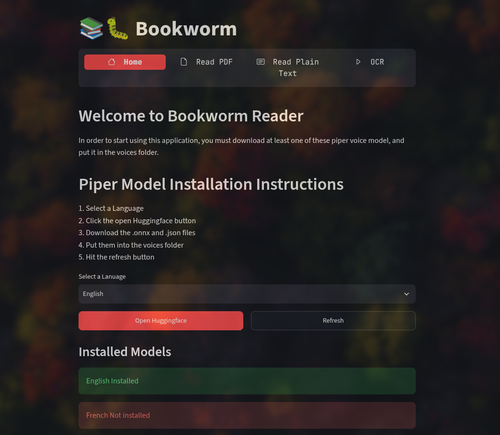
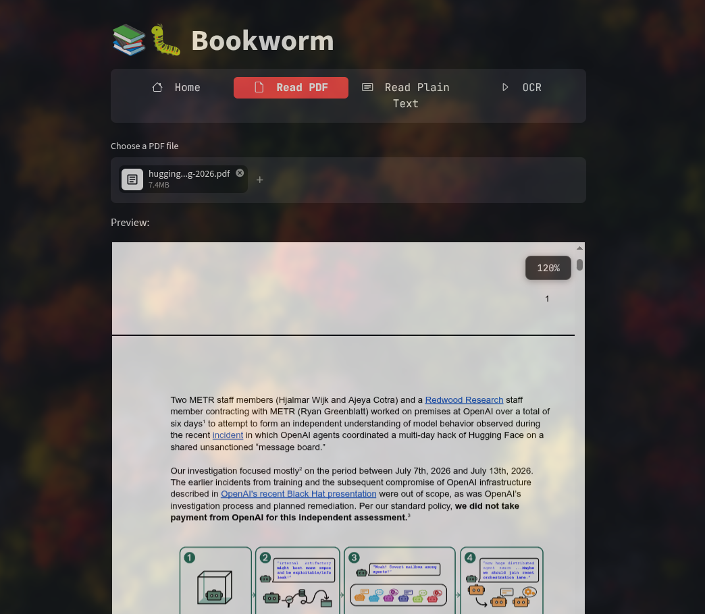
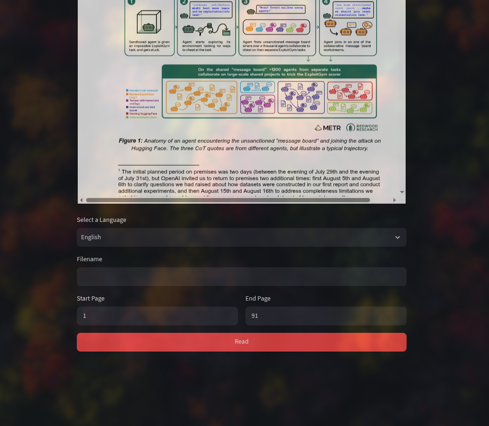
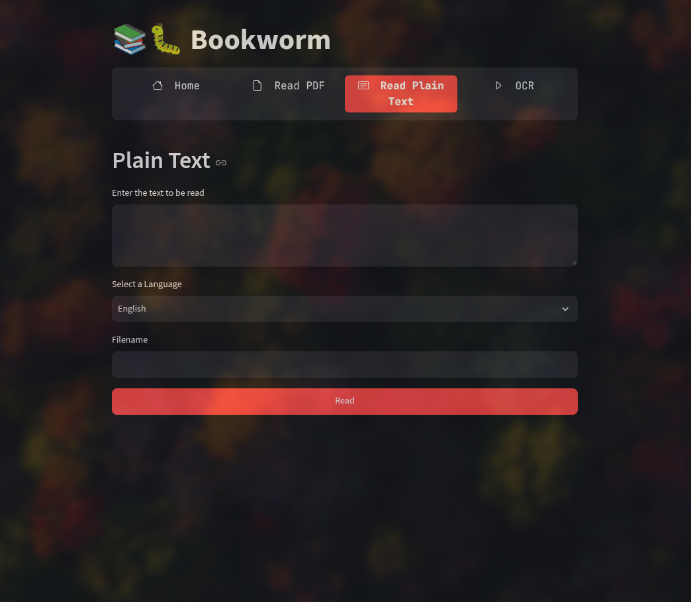
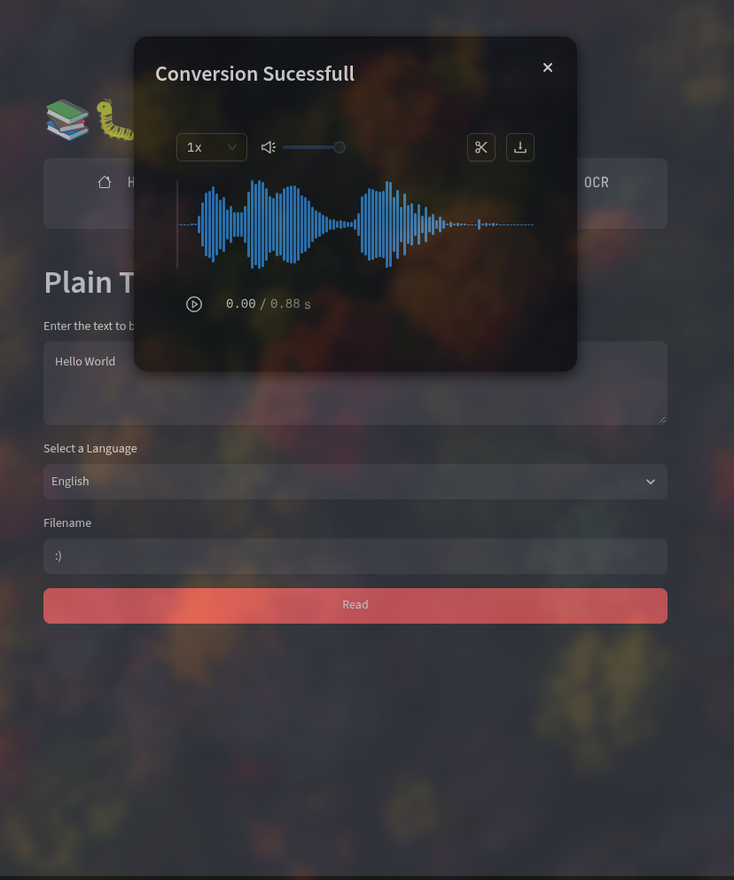

# 📚🐛 Bookworm-Reader
Convert's PDF, Plain-text and image files into an audio file in a bunch of different languages offline.

# What is this?
This is a simple application that provides a Web UI that lets you make audio files from plain text, PDF's and OCR all offline and for free.

# Planned features
✅ PDF reading

✅ Plain Text Reading

□  OCR for PDF's without text data and images

□  Better Home Menu

✅ Installer

□  More if i think of anything

#Screenshots

Landing

PDF Reader

Plain Text Reader

Audio Preview

## Acknowledgments
Everything listed in `requirements.txt`
